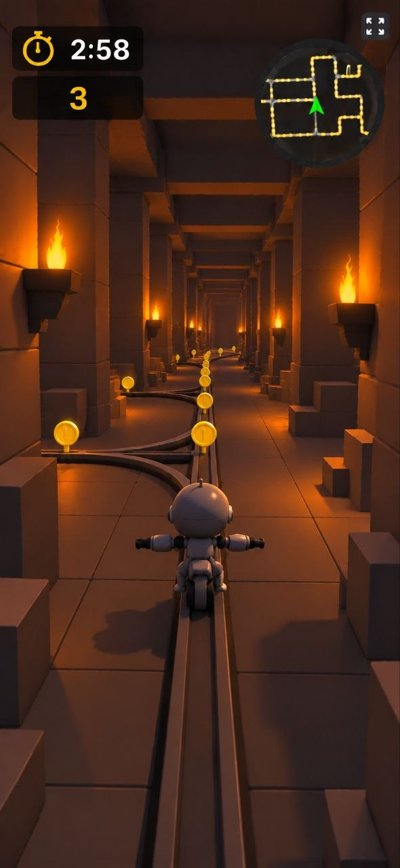
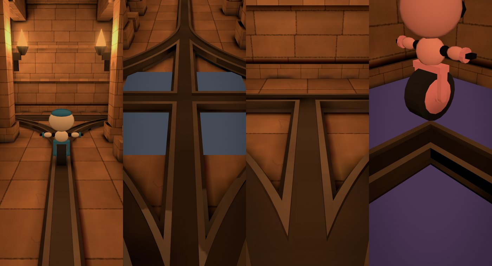

# Engine request #11: grooved rail profile with junction cut-outs

Requested Nov 28 2026 (Vlad's reference image `rail_reference.png` in the project thread).
A general rails-module feature, not Coin Rush specific: any game can pick it.

## What

Today the rails module sweeps a round tube (`RailNetwork.radius`, 12 sides) and puts a ball on
every node. Wanted: a **grooved track**, like a real wheel track: two raised lips with a groove
in the middle that the robot's wheel runs in, and a low foot on the floor.

At every junction the groove has to stay open for the wheel: where another rail (a T's stem,
an X's cross rail, a corner curve leaving at its switch point) joins, the through rail's lip
is cut open, and the joining rail's lips stop at the through rail's groove. Same at plain
corners (2-port nodes): the outside lips close the corner, the groove turns with the wheel.



Preview, made with the reference script below and baked in the Coin Rush maze (rails lowered
to the floor): a straight into a T, an X from above, the cut-outs at a T and a corner.



## Proposed API (schema `modules/rails/schemas/rails.schema`)

`RailNetwork` gets a style choice; the default keeps today's look, so no migration.

```
component RailNetwork {
    rails, material, radius        // as now; radius is only used by "tube"
    profile:       string = "tube"  // "tube" (today) or "grooved"
    groove_width:  f32 = 0.26  @min(0.02) @unit("m")   // Between the lips (wheel 0.2 m).
    lip_width:     f32 = 0.07  @min(0.01) @unit("m")   // Each raised edge.
    lip_height:    f32 = 0.06  @min(0)    @unit("m")   // Lip top above the groove floor.
    foot_width:    f32 = 0.06  @min(0)    @unit("m")   // Flange outside each lip (0 = none).
    foot_height:   f32 = 0.06  @min(0)    @unit("m")   // Flange top below the groove floor.
    depth:         f32 = 0.12  @min(0)    @unit("m")   // How far the sides go below the
                                                       // groove floor (down to the ground).
    groove_material: string = "" @asset(".material.json")  // "" = `material`.
}
```

- **The rail's centre line is the groove floor** (the wheel's contact line) for "grooved".
  Robots ride with their wheel bottom on it: `robots_module.cpp` adds `up * radius` today
  (`base = p.position + p.up * rail_radius`); for "grooved" that offset is 0. A small
  `rails::ride_height(const RailNetwork&)` keeps that in one place (also used for the
  `tag_hit` effect height).
- Probes: unchanged (0.5 m above the rail).

## How to build it (`modules/rails/render/rail_mesh.cpp`)

The profile is bands from the centre out, each a half width and a height relative to the
groove floor: groove (`groove_width / 2`, 0), lip (`+ lip_width`, `+lip_height`), foot
(`+ foot_width`, `-foot_height`); the outermost side goes down to `-depth`.

1. **Along a rail** (away from junctions): sweep that profile along the baked frames like the
   tube today (position + `side * offset` + `up * height`). Flat shaded faces (separate
   vertices per face, so the lips have crisp edges), probe light per vertex as now.
2. **Junction patches**: every node with 3+ ports, and every 2-port node whose ports aren't
   straight across (a corner), gets one patch mesh covering the node out to
   `max switch distance + groove_width / 2 + lip_width + foot_width + a little`. The swept
   rails stop at the patch edge with a straight cut across, so patch and sweep share the same
   cross-section there (no seam).
   Inside the patch, in the node's plane (x, z in the node frame; heights along its up):
   - centre lines = the arms (clipped to the patch) + the node's junction rails (from
     `BakeCache::junctions()`, the same curves robots ride);
   - `U_k` = union of all centre lines grown by band k's half width (arms end square past the
     node, junction rails end flat);
   - top surface: `region_0 = U_0` (groove floor), `region_k = U_k - U_(k-1)` at band k's
     height. That single rule makes every groove cut every other rail's lips: T, X, corner and
     the switch where a corner curve leaves the straight;
   - triangulate each region flat; walls go down along every region edge to whatever is next
     to it (a lower band, or `-depth` outside everything);
   - drop slivers thinner than about 1 cm (shrink by 5 mm and grow back) where two grooves
     run apart at a switch, so no needle-thin lip tips.
   Libraries: Clipper2 (offsets + booleans, Boost licence) and mapbox `earcut.hpp`
   (triangulating polygons with holes, ISC), both header-only, into `third_party/`.
3. **Dead ends** (1-port node): close the groove with a lip-height end block (a buffer stop).
4. Rebuild a patch only when its node, its arms' bakes or its junction rails changed (same as
   edges today), so dragging a node in the editor stays live.
5. Junctions that aren't flat (banked or on a slope): build the patch in the node's frame as
   above; arms that tilt away within the patch are fine for Robotag's layouts. Good enough.

Reference implementation (plan view, flat railways): Coin Rush
`docs/engine-requests/rail-profile/reference.py` (Python + shapely). It builds the whole maze
as one mesh with the method of step 2 (no sweep / patch split, which the engine needs for live
editing and probe light), about 18k triangles (16.6k rail + 1.8k groove) for Coin Rush's 16 nodes / 23 rails / 32
junction rails.

## Editor and checks

- Inspector: the RailNetwork fields above (profile as a combo; the groove fields only for
  "grooved").
- Tests (`rt_rails_render_test`): a grooved straight has the expected cross-section; at a T
  the through rail has no lip triangles over the stem's groove (sample points along the stem's
  centre line hit only groove-floor height); at an X, and along a junction rail from its
  switch point, the same; patch / sweep boundary vertices match.
- Sandbox: switch the sandbox railway to "grooved" (4 T + 1 X) as the sample.
- Skills: `rail-layout` (choosing a profile), `engine-api-for-games` (RailNetwork fields,
  ride height).

## Coin Rush after it lands

- `tools/maze_layout.py`: `RAIL_Y` 0.3 -> about 0.12, so the track sits low on the floor like
  the reference (the groove floor is the centre line now; the sides reach the floor with
  `depth` = 0.12). The coins follow (`kCoinHeight` above the rail).
- Main scene `RailNetwork`: `profile` "grooved", rail material dark iron with a highlight
  (`groove_material` darker). The tunnel look (`tools/environment.py`) needs no change; the
  rails stay probe-lit, not Static, so the lightmap budget is unchanged.
